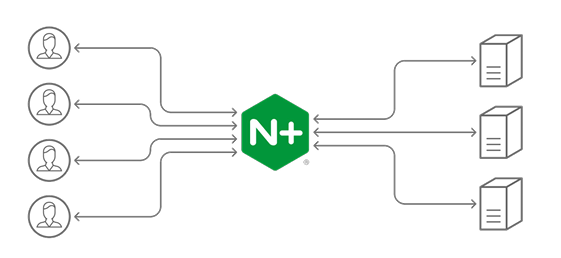
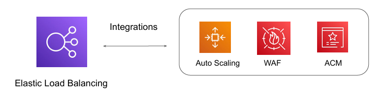
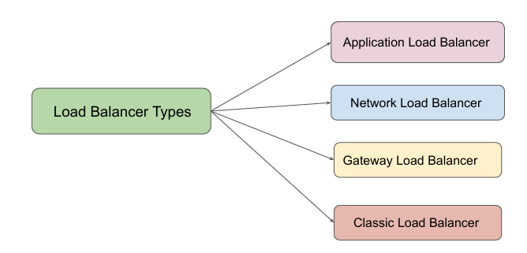
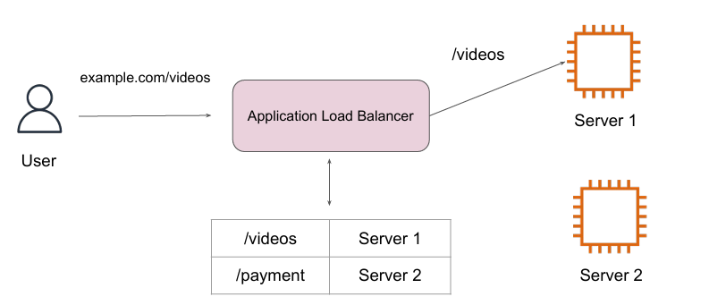
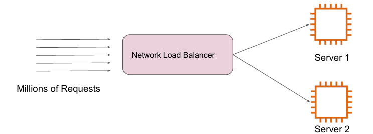
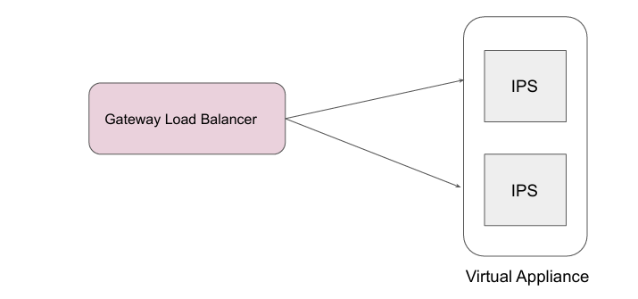
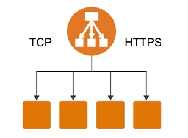

# Load Balancing in AWS

## Basics of Load Balancing
There are multiple software and hardware based load balancing solutions available.
Some of the popular ones include Nginx, HA Proxy and others.

## Challenges with Maintaining Load Balancing Solution

If you are using a load balancing solution, various responsibilities falls to customer.
Some of these include:

1. High-Availability of Load Balancers.

2. Security.

3. Performance.

## Basics of Elastic Load Balancing Service

AWS offers managed load balancing solutions for wide variety of use-cases.

These solutions are offered under the Elastic Load Balancing feature.

Tight integration with multiple AWS Services.

## Types of Load Balancers

There are 4 primary type of Load Balancer offerings available.

## Application Load Balancers

An Application Load Balancer makes routing decisions at the application layer (HTTP/HTTPS)

## Network Load Balancers

A Network Load Balancer makes routing decisions at the transport layer (TCP/UDP/SSL). 
It can handle millions of requests per second.

Not all of the applications work on HTTP/HTTPS protocol.

## Gateway Load Balancers

Gateway Load Balancers allow you to deploy, scale, and manage virtual appliances, such as firewalls, 
intrusion detection and prevention systems, and deep packet inspection systems

## Classic Load Balancers

A Classic Load Balancer makes routing decisions at either the transport layer (TCP/SSL) or the 
application layer (HTTP/HTTPS).

Previous Generation Load Balancer and not recommended.

### Point to Note

Since these are previous-generation load balancers, various advanced features 
are missing. AWS recommends using Application/Network load balancer instead, 
based on the requirement.

Example:
1. Does not support native HTTP/2 protocol.

2. IP address as targets are not supported.

3. Path based routing is not supported. (eg: /images should go to server 1 & 
/php to server 02)

## Summary Slide

| Load Balancer | Important Notes |
| --- | --- |
| Application Load Balancer | Use when you have websites/applications at L7 (HTTP/HTTPS). |
| Network Load Balancers | TCP and UDP based applications. Requirement to handle millions of requests per second. Ultra high performance. |
| Gateway Load Balancer | Use when you have virtual appliances:  IDS/IPS Firewalls |
