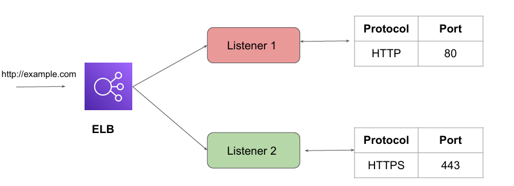
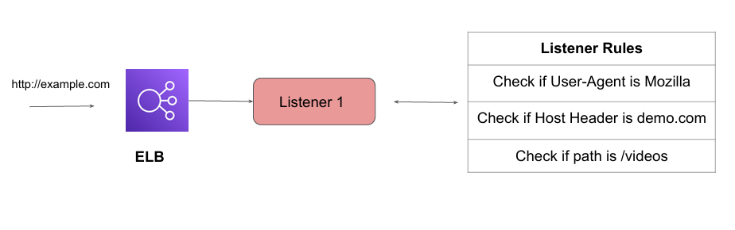
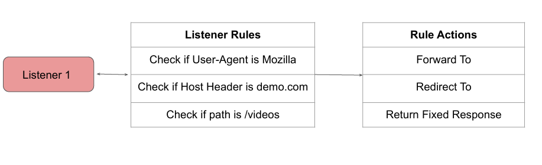
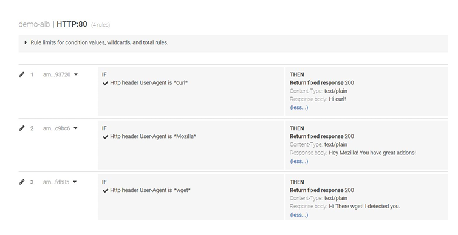
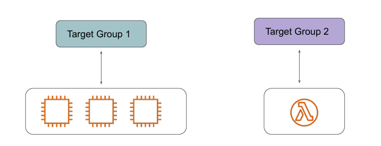
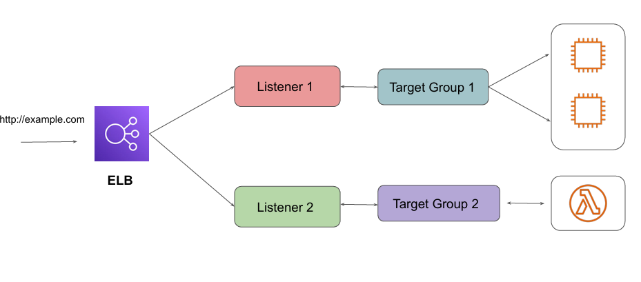

# Listener & Target Groups

## Understanding Listeners
A listener is a process that checks for connection requests, using the protocol and port that you 
configure.

## Listener Rules
Each listener has a rule based on which an action is taken based on a request.

## Listener Rule Actions

If a request matches a specific rule, what action you want to perform on that request is 
determined in the Rule Actions.

 

## Understanding Target Groups
Target group is used to route requests to one or more registered targets. 
These targets can be EC2 instances, Lambda Functions, and others.

## Overall Workflow

